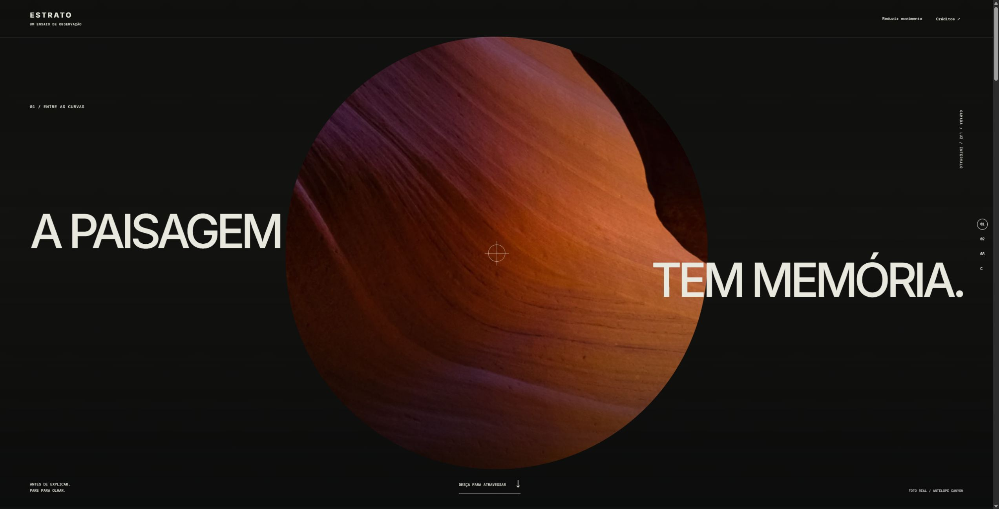

# Estrato

Uma expedição visual em três paisagens reais, com narrativa de rolagem e caderno de campo.

**[Demonstração](https://gustapaz.github.io/estrato/)** · VanJS + GSAP ScrollTrigger + TypeScript + Vite



## Experiência completa

- Abertura em máscara orgânica que se amplia até preencher a tela, texto em contramovimento e retículo que se dissolve.
- Plano rochoso com recorte diagonal e mudança de perspectiva até o horizonte.
- Rolagem nativa, índice de capítulos, links diretos e alternativa estática pelo botão de movimento e pela preferência do sistema.
- Caderno com notas de até 800 caracteres por paisagem, favoritos, filtro e exportação TXT.

Conteúdo de curadoria autoral e fotografias reais licenciadas. Não é um guia geológico ou turístico. Dados do caderno são locais e começam vazios, sem API, backend, conta ou sincronização. O TXT é um registro legível, sem importação.

## Executar

Node.js 24.

```sh
npm ci
npm run dev
npm test
npm run check
npm run build
npm run preview
```

Exportação estática em `dist`, base `/estrato/`, publicação gratuita por GitHub Actions e Pages. Capítulos são HTML estático; VanJS cuida do caderno e GSAP do movimento. Sem serviço ou fonte remota em runtime.

## Licenças

Código MIT, Gustavo Paz. Fotografias do Pexels com origem, autor, licença, alterações e hash em [docs/assets.json](docs/assets.json), além dos créditos na interface. Sem imagens geradas por IA. Licenças de Inter, DM Mono e VanJS em `docs/`; GSAP usa sua licença Standard no-charge, cujo aviso é preservado. A licença do código não substitui as condições dos assets.

[Direção visual](docs/design.md) · [Validação](docs/validacao.md)
